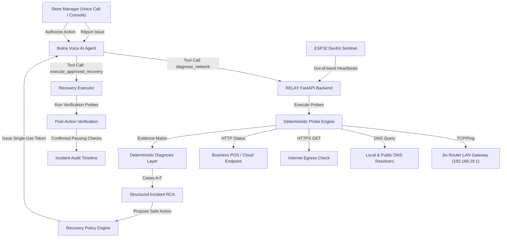

# RELAY System Architecture

## 1. High-Level Overview

RELAY is a voice-native incident resolution platform designed for physical business locations (cafes, retail stores, medical clinics) connected to standard consumer or enterprise broadband (such as Jio Home Gateway).

When non-technical personnel encounter technology disruptions ("The billing application is not loading"), RELAY investigates the issue, gathers real probe evidence, classifies the root cause deterministically, recommends an allowlisted recovery action, obtains authorized confirmation via single-use approval tokens, executes the recovery, and mathematically verifies recovery through post-action diagnostic probes.

---

## 2. Component Boundaries

### A. API Routing & Security (`app/main.py`, `app/security/`)
- **Bearer Token Authentication**: Protects operator, management, and Bolna tool call endpoints. Uses constant-time string comparison (`secrets.compare_digest`).
- **Device Token Authentication**: Validates out-of-band telemetry from IoT hardware monitors (`X-Device-Token` header).
- **SSRF Target Validation**: Restricts probe targets to an explicit allowlist. Blocks internal network scanning, loopback probes (unless configured as gateway target), and non-HTTP schemes.
- **CORS Middleware**: Securely enables cross-origin requests from the React operations frontend.

### B. Diagnostic Probe Engine (`app/services/probes.py`)
- Independent, typed diagnostic probes:
  1. `gateway_reachability`: Tests local LAN reachability to router gateway (192.168.29.1) with bounded 800ms timeouts.
  2. `dns_resolution`: Validates allowlisted hostname resolution with latency measurement.
  3. `https_egress`: Tests general internet HTTPS reachability with redirect limits.
  4. `business_service`: Tests the specific critical business URL with dependency tracking.
- Dependency injection architecture allows deterministic offline testing without live internet.

### C. Diagnosis & Classification Engine (`app/services/diagnosis.py`)
- Strict separation between **Observed Facts** and **Hypotheses**.
- Deterministic decision trees:
  - **Case A**: Gateway reachable, DNS resolution fails, business endpoint unreachable &rarr; *Probable DNS resolver outage*.
  - **Case B**: Gateway unreachable &rarr; *Local LAN / physical cable / router power fault*.
  - **Case C**: DNS and general egress succeed, but business endpoint fails &rarr; *Isolated vendor / upstream application outage*.
  - **Case D**: Network probes healthy, but ESP32 heartbeat is stale &rarr; *Monitoring device unplugged / offline; site network operational*.
  - **Case E**: All probes pass despite user complaint &rarr; *Issue not reproduced; structured follow-up questions*.
  - **Case F**: Recovery executed, but post-action checks fail &rarr; *Recovery unsuccessful; never report false resolution*.

### D. Recovery Action Framework (`app/services/recovery_policy.py`, `app/services/recovery_executor.py`, `app/services/verification.py`)
- Strictly allowlisted actions (`clear_demo_dns_fault`, `flush_dns_cache_simulated`, `switch_failover_dns_simulated`).
- Parameter schema validation.
- Cryptographically signed single-use expiring approval tokens (`apr_<token>`).
- Atomically consumed tokens prevent replay attacks.
- Mandatory post-action verification: Reruns diagnostic probes and computes the delta. Success is reported **only** when all checks pass.

### E. Persistence Layer (`app/storage.py`)
- SQLite storage with relational foreign keys and indexes:
  - `incidents`: Root incident records with status and diagnosis.
  - `incident_timeline`: Chronological audit trail of diagnostic runs, proposals, approvals, executions, and verification outcomes.
  - `recovery_actions`: Proposed actions, impact disclosures, tokens, and execution results.
  - `device_heartbeats`: IoT telemetry (uptime, RSSI, free heap, cycle count).
  - `audit_logs`: Security audit log.

### F. Operations Console Frontend (`frontend/`)
- Built with React 19, TypeScript, and Vite.
- Custom B2B dark-theme operations design system.
- Five dedicated views:
  1. **Overview Dashboard**: Fleet health, aggregate metrics, open incidents, device states.
  2. **Site Detail**: Live probe matrix, hardware sentinel stats, dependency map.
  3. **Incident Detail (RCA)**: User complaint, evidence breakdown, timeline, authorization dialog.
  4. **Voice Console**: Interactive voice assistant simulation, tool traces, Bolna schema viewer.
  5. **Diagnostics Playground**: 6-step testing lab for fault injection, diagnosis, and verified recovery.
